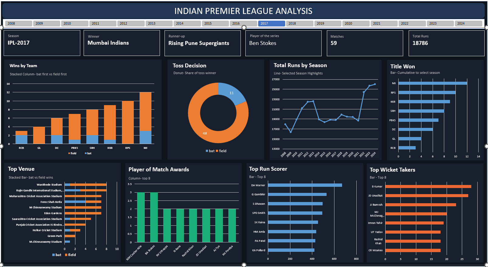

# 🏏 Indian Premier League (IPL) Analysis Dashboard

An interactive Excel dashboard that analyzes IPL data from 2008 to 2024, with season-wise filters to explore match results, toss decisions, run trends, venues, and top player performances.



---

## 📌 Project Overview

The Indian Premier League is one of the most popular cricket leagues in the world. This project turns raw IPL match data into a single interactive dashboard that answers questions such as:

- Which teams win the most matches, and do they win batting first or fielding first?
- Do teams prefer to bat or field after winning the toss?
- How have total runs changed from season to season?
- Which venues, players, and bowlers stand out?

Use the **season slicer** at the top to switch between IPL 2008 and IPL 2024. All visuals and KPI cards update automatically.

---

## 📊 Dashboard Components

**KPI Cards**
- Season, Winner, Runner-up, Player of the Series, Matches, Total Runs

**Charts**
| Chart | Type | Purpose |
|---|---|---|
| Wins by Team | Stacked column | Wins when batting first vs fielding first |
| Toss Decision | Donut | Share of toss winners choosing to bat or field |
| Total Runs by Season | Line | Run trend with the selected season highlighted |
| Title Won | Bar | Team comparison for the selected season |
| Top Venue | Stacked bar | Bat-first vs field-first wins by stadium |
| Player of Match Awards | Column | Top 8 players by award count |
| Top Run Scorer | Bar | Top 8 batters |
| Top Wicket Takers | Bar | Top 8 bowlers |

---

## 🔍 Key Insights (IPL 2024)

- **Champions:** Kolkata Knight Riders won the title, with Sunrisers Hyderabad as runners-up.
- **Player of the Series:** Sunil Narine.
- **Matches and runs:** 71 matches were analyzed, with 25,971 total runs scored.
- **Toss decision:** Teams chose to **field first in 52 matches** and bat first in 19, showing a strong preference for chasing.
- **Team wins:** Kolkata Knight Riders recorded the most wins among all teams.
- **Venue:** MA Chidambaram Stadium, Chepauk, hosted the most matches among the top venues.
- **Top performers:** V Kohli leads the run scorers, HV Patel leads the wicket takers, and TM Head, SP Narine, and Abhishek Sharma lead the Player of the Match awards.
- **Run trend:** Total runs per season rose sharply from 2022 onward, with 2024 reaching the highest total in the chart.

---

## 🧰 Tools & Skills Used

- **Microsoft Excel**
- **Pivot Tables and Pivot Charts**
- **Slicers** for interactive filtering
- **Data Cleaning and Preparation**
- **Data Visualization and Dashboard Design**

---

## 📁 Repository Structure

```
├── IPL-Analysis-Dashboard.xlsx   # Interactive Excel dashboard
├── README.md
├── LICENSE
├── data/
│   ├── matches.xlsx               # Match-level data
│   └── deliveries.xlsx            # Ball-by-ball data
└── images/
    └── dashboard.png             # Dashboard preview
```

> Update the file names above to match your actual files.

---

## 🚀 How to Use

1. Download or clone this repository.
2. Open the Excel file in **Microsoft Excel**.
3. Click a season in the slicer at the top to filter the dashboard.
4. Hover over the charts to see detailed values.

---

## 💡 Business Value

- Helps teams and analysts understand the impact of toss decisions on match results.
- Shows which venues favor batting first or chasing.
- Highlights player performance for team selection and fantasy cricket analysis.
- Tracks how scoring trends have changed over the years.

---

## 👤 Author

**Shaikh Tauqeer**

- 📧 Email: [shaikhtauqeer1786@gmail.com](mailto:shaikhtauqeer1786@gmail.com)
- 🔗 LinkedIn: [linkedin.com/in/shaikhtauqeer](https://www.linkedin.com/in/shaikhtauqeer)
- 💻 GitHub: [github.com/Tauqeer1786](https://github.com/Tauqeer1786)

---

⭐ If you found this project useful, consider giving it a star!
